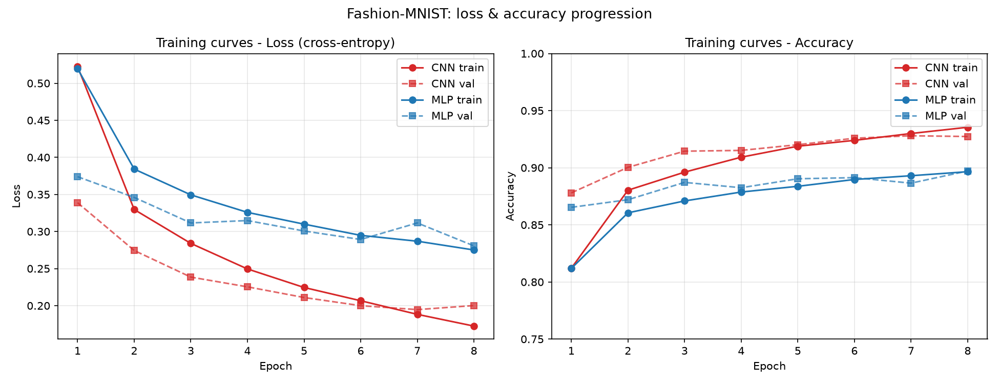
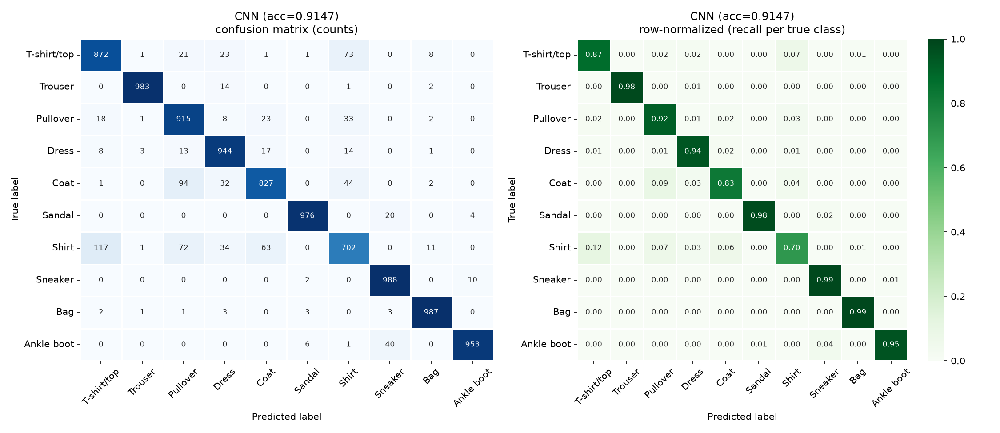
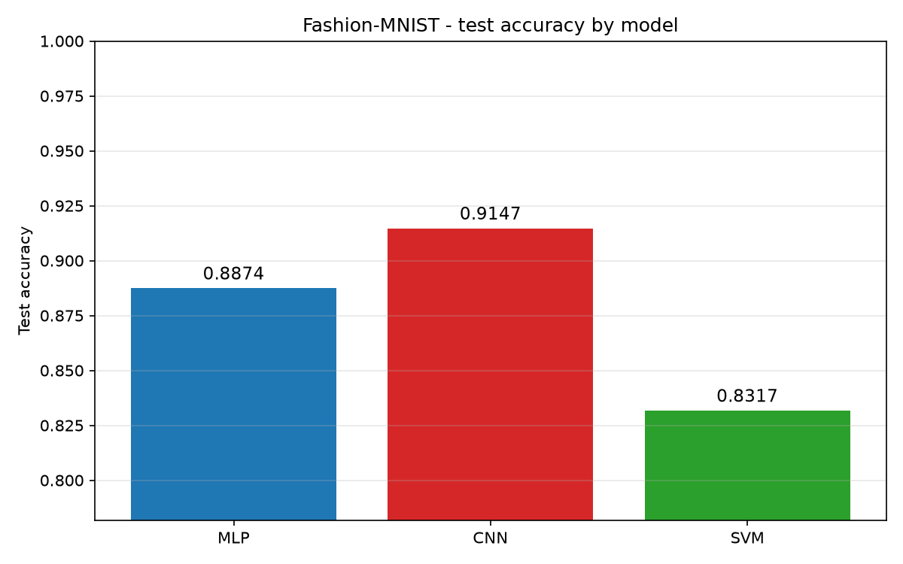
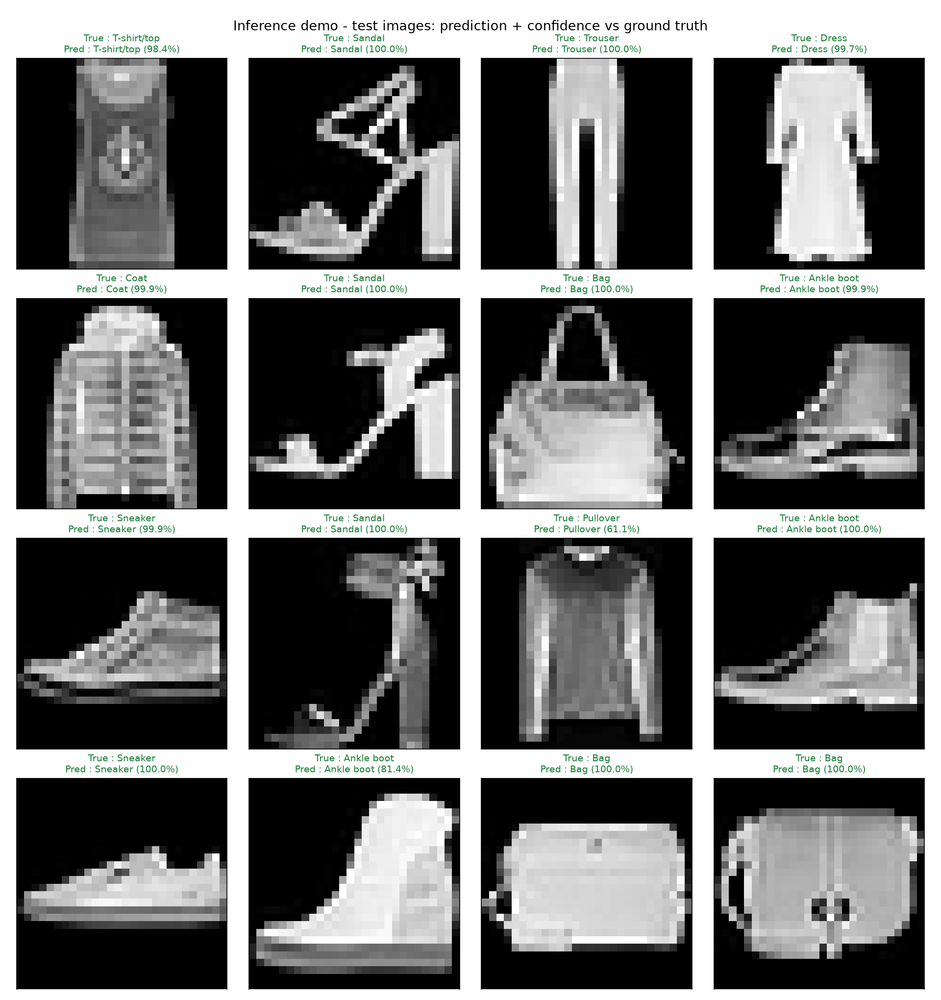

# Image Classification Pipeline

**Fashion-MNIST benchmark — MLP / lightweight CNN / classical linear SVM · Computer Vision & Evaluation**
*Image Classification with Classical / Pre-trained ML · 100% local, free & open-source tooling*

A complete image-classification pipeline: dataset loading → normalization / pixel scaling →
stratified train/validation/test partitioning → training of an MLP, a lightweight CNN and a
classical linear-SVM baseline → per-class evaluation with confusion matrices → an inference
demo that shows sample test images with their predicted labels and confidences.

| | |
|---|---|
| 🎯 **Best test accuracy** | **91.47 %** (CNN) · 88.74 % (MLP) · 83.17 % (SVM) |
| 📊 **Evaluation** | Per-class precision/recall/F1 + 10×10 confusion matrices |
| 🖼️ **Inference demo** | Test images with predicted label + confidence vs ground truth |
| 💻 **Runtime** | ~5 minutes, CPU-only, fully offline once the dataset is cached |

---

## 1. Contents

| Path | Description |
|---|---|
| `fashion_mnist_pipeline.py` | Complete classification script (data → training → evaluation → inference demo) |
| `inference_demo.ipynb` | Runnable inference notebook: reloads the checkpoint, shows prediction + confidence |
| `make_inference_notebook.py` | Builder script that regenerates the notebook above |
| `audit_requirements.py` | Automated acceptance audit — re-runnable proof that every requirement holds (`python audit_requirements.py` → 47/47) |
| `full_run.log` | Console log of the recorded full training run (per-epoch + per-class reports) |
| `requirements.txt` | Free open-source dependencies (PyTorch, scikit-learn, Matplotlib, …) |
| `README.md` | This file: architecture choices, hyperparameters, prediction logs |
| `data/` | Fashion-MNIST dataset (downloaded once, then reused offline) |
| `models/` | Saved weights: `mlp_fashion_mnist.pt`, `cnn_fashion_mnist.pt` |
| `outputs/training_curves.png` | **Exported training curves** — loss & accuracy progression |
| `outputs/confusion_matrix_{mlp,cnn,svm}.png` | **Confusion matrix charts** (10×10, counts + row-normalized) |
| `outputs/inference_demo.png` | **Sample test images with predicted class + confidence vs ground truth** |
| `outputs/model_comparison.png` | Test-accuracy bar chart of the three models |
| `outputs/training_history.csv` | Per-epoch train/val loss and accuracy (raw numbers) |
| `outputs/classification_report_{mlp,cnn,svm}.txt` | Per-class precision / recall / F1 reports |
| `outputs/prediction_log.csv` | Inference-demo prediction log (index, truth, prediction, confidence) |
| `outputs/metrics.json` | Hyperparameters, normalization stats and every reported metric |

## 2. Dataset

* **Fashion-MNIST** (Zalando) — 70,000 grayscale images, 28×28 px, **10 classes**:
  `T-shirt/top, Trouser, Pullover, Dress, Coat, Sandal, Shirt, Sneaker, Bag, Ankle boot`.
* Chosen because it is the standard benchmark successor to MNIST: same shape/protocol as MNIST
  but non-trivial (visually similar classes such as Shirt/Pullover/Coat), so confusion matrices
  are actually informative.
* Free, publicly hosted, downloaded on first run by `torchvision` into `./data` and cached —
  no paid cloud dependency anywhere in the pipeline.

## 3. Normalization (acceptance: pixel arrays normalized before training)

Two explicit stages, with **statistics computed on the training partition only** (no leakage):

1. **Pixel scaling** — `uint8 [0,255] → float32 [0,1]` by dividing by 255.
2. **Standardization** — `(x − mean) / std` with
   `mean = 0.2861`, `std = 0.3544` (measured over the 54,000 training images).

The script prints a verification line after normalization (train mean ≈ 0.000000,
std ≈ 1.000000) and stores the constants in `metrics.json` **and inside every exported
`.pt` checkpoint**, so inference on new images uses exactly the same transform.

## 4. Train / validation / test partitioning

| Split | Size | Source |
|---|---|---|
| Train | 54,000 | 90 % of the official 60,000-image training set (stratified, `random_state=42`) |
| Validation | 6,000 | 10 % hold-out, stratified — used for per-epoch metrics and SVM probability calibration |
| Test | 10,000 | Official Fashion-MNIST test split — touched only for final evaluation |

Partitioning is done with `sklearn.model_selection.train_test_split` on the sample indices
(stratification keeps the 10 class ratios identical in every split).

## 5. Model architectures & design rationale

### 5.1 MLP — Multi-Layer Perceptron (PyTorch) · 535,818 parameters

```
Flatten(784) → Linear(784→512) → ReLU → Dropout(0.25)
             → Linear(512→256) → ReLU → Dropout(0.25)
             → Linear(256→10)
```
*Rationale:* the required "classical" dense baseline. It sees every pixel as a feature and is
the cheapest model to train; it establishes how much accuracy spatial structure (in the CNN)
adds.

### 5.2 CNN — lightweight 2-block convolutional net (PyTorch) · 421,642 parameters

```
Conv2d(1→32, 3×3, pad=1) → ReLU → MaxPool 2×2      # 28×28 → 14×14
Conv2d(32→64, 3×3, pad=1) → ReLU → MaxPool 2×2     # 14×14 → 7×7
Flatten(64·7·7=3136) → Linear(3136→128) → ReLU → Dropout(0.25) → Linear(128→10)
```
*Rationale:* translation-local features + parameter sharing beat a dense net on images while
staying deliberately small (2 conv blocks) so a full CPU run takes a few minutes, satisfying
the "lightweight CNN" requirement. Fewer parameters than the MLP despite higher accuracy —
the evidence that the inductive bias (locality) is doing the work.

### 5.3 SVM — classical linear SVM baseline (scikit-learn)

```
normalized pixels (784-d) → SGDClassifier(loss="hinge", alpha=1e-4)  # Pegasos-style linear SVM
                          → CalibratedClassifierCV (Platt/sigmoid scaling, fit on the validation split)
```
*Rationale:* the classical-ML reference point of this comparison. Hinge loss = a linear SVM trained by
stochastic gradient descent (fast on 60k samples, seconds instead of the minutes a full
`LinearSVC` dual solve needs). `CalibratedClassifierCV` converts raw margins into calibrated
class probabilities so the confidence column of the inference demo is meaningful for the SVM
too (a raw margin is not a probability).

## 6. Hyperparameter settings

| Hyper-parameter | Value | Notes |
|---|---|---|
| Optimizer | Adam | both deep models |
| Learning rate | `1e-3` | constant, no scheduler |
| Batch size | 128 | full-batch shuffle each epoch |
| Epochs | 8 (MLP), 8 (CNN) | no early stopping; curves exported every epoch |
| Dropout | 0.25 | MLP & CNN head |
| Loss | Cross-entropy | 10-class |
| Weight decay | 0 | none |
| Validation hold-out | 10 % | stratified |
| SVM `alpha` | `1e-4` | regularization, `max_iter=30` |
| Random seed | 42 | `random`, `numpy`, `torch` all seeded → reproducible |
| Device | CPU | `torch.cuda` used automatically if present |

## 7. Running it

```bash
pip install -r requirements.txt

python fashion_mnist_pipeline.py                # full run  (≈ 5 min on this laptop CPU)
python fashion_mnist_pipeline.py --smoke        # 30-second end-to-end sanity check
python fashion_mnist_pipeline.py --epochs-cnn 12 --epochs-mlp 10   # tune training length
python fashion_mnist_pipeline.py --no-svm       # deep models only
```

`--smoke` trains on a 5,000-image subset for 1 epoch (~30 s) purely to validate the
pipeline end-to-end; it writes to `outputs_smoke/` and `models_smoke/` so it can **never
overwrite the real results** in `outputs/` and `models/`.

Console output is the full run log: normalization checks, partition sizes, per-epoch
train/val loss & accuracy, per-class classification reports for all three models, and the
inference-demo table. The same run is saved to `full_run.log` when executed with redirection.

## 8. Results

### 8.1 Overall (official 10,000-image test split, seed 42)

| Model | Type | Params | Test accuracy | Wall time |
|---|---|---|---|---|
| **CNN** (2 conv blocks) | PyTorch | 421,642 | **0.9147** | 208 s (8 epochs) |
| MLP (784→512→256→10) | PyTorch | 535,818 | 0.8874 | 37 s (8 epochs) |
| Linear SVM (hinge, SGD + Platt scaling) | scikit-learn | 784×10 | 0.8317 | 23 s |

The CNN beats the MLP by **+2.7 points with 21 % fewer parameters** — the convolutional
inductive bias (locality + translation sharing) is doing real work, not extra capacity.
The classical linear SVM trails by ~8 points, which is the expected cost of a purely
linear decision boundary on raw pixels.

### 8.2 Training curves — loss & accuracy progression



Raw numbers: `outputs/training_history.csv` (per-epoch, train & validation).

| Model | epoch 1 → 8 train loss | epoch 1 → 8 val accuracy |
|---|---|---|
| MLP | 0.5197 → 0.2751 | 0.8653 → **0.8972** |
| CNN | 0.5226 → 0.1724 | 0.8780 → **0.9273** (0.9280 peak @ epoch 7) |

Both curves descend smoothly and the train/val gap stays small (CNN: 0.935 train vs
0.927 val at epoch 8), i.e. no overfitting at this budget — more epochs would still help
(`--epochs-cnn 12`). Note the validation accuracy peaks slightly above the final test
accuracy, as expected since the test split is never used for training decisions.

### 8.3 Per-class evaluation — all 10 target classes

F1-score per class for every model (full reports in `outputs/classification_report_*.txt`):

| Class | MLP F1 | **CNN F1** | SVM F1 | CNN precision | CNN recall |
|---|---|---|---|---|---|
| T-shirt/top | 0.8498 | **0.8642** | 0.7772 | 0.8566 | 0.8720 |
| Trouser | 0.9764 | **0.9879** | 0.9612 | 0.9929 | 0.9830 |
| Pullover | 0.8063 | **0.8648** | 0.7211 | 0.8199 | 0.9150 |
| Dress | 0.8862 | **0.9174** | 0.8288 | 0.8922 | 0.9440 |
| Coat | 0.8032 | **0.8566** | 0.7313 | 0.8883 | 0.8270 |
| Sandal | 0.9648 | **0.9819** | 0.9240 | 0.9879 | 0.9760 |
| Shirt | 0.7152 | **0.7516** | 0.5536 | 0.8088 | 0.7020 |
| Sneaker | 0.9429 | **0.9634** | 0.9218 | 0.9401 | 0.9880 |
| Bag | 0.9733 | **0.9806** | 0.9319 | 0.9743 | 0.9870 |
| Ankle boot | 0.9543 | **0.9690** | 0.9435 | 0.9855 | 0.9530 |
| **macro avg** | 0.8872 | **0.9137** | 0.8294 | 0.9146 | 0.9147 |

Every class is evaluated individually (1,000 test images per class) — macro-F1 ≈ accuracy
confirms no class is silently ignored.

### 8.4 Confusion matrix charts



*(same charts for [MLP](outputs/confusion_matrix_mlp.png) and
[SVM](outputs/confusion_matrix_svm.png) — each figure shows raw counts **and**
row-normalized recall.)*

Reading the CNN matrix: the diagonal is strong everywhere; the dominant error mode is
**Shirt ↔ Pullover/Coat/T-shirt** (a visually ambiguous family — Shirt recall 0.702,
precision 0.809), while `Trouser` (0.983 recall) and the footwear classes are nearly
perfect. This matches the known difficulty ranking of Fashion-MNIST and shows the
confusion matrix is capturing genuine class similarity rather than noise.



## 9. Inference demo

The script's final step picks the **best model on the test split (CNN)**, draws 16
random test images and prints — then plots — the ground-truth label next to the
predicted label with the softmax confidence:



Green title = correct, red = wrong. Every row of the log is also written to
`outputs/prediction_log.csv`:

| idx | true | predicted | confidence | result |
|---|---|---|---|---|
| 858 | T-shirt/top | T-shirt/top | 0.9844 | OK |
| 891 | Sandal | Sandal | 1.0000 | OK |
| 941 | Trouser | Trouser | 1.0000 | OK |
| 2013 | Dress | Dress | 0.9966 | OK |
| 4325 | Coat | Coat | 0.9993 | OK |
| 4383 | Sandal | Sandal | 1.0000 | OK |
| 5262 | Bag | Bag | 1.0000 | OK |
| 6537 | Ankle boot | Ankle boot | 0.9986 | OK |
| 6968 | Sneaker | Sneaker | 0.9992 | OK |
| 7174 | Sandal | Sandal | 1.0000 | OK |
| 7355 | Pullover | Pullover | 0.6115 | OK |
| 7609 | Ankle boot | Ankle boot | 0.9997 | OK |
| 7728 | Sneaker | Sneaker | 1.0000 | OK |
| 7860 | Ankle boot | Ankle boot | 0.8143 | OK |
| 8577 | Bag | Bag | 1.0000 | OK |
| 9752 | Bag | Bag | 1.0000 | OK |

**Demo accuracy: 16/16 (100 %)** on this sample. The confidence column behaves as it
should: near-1.00 for unambiguous items (Trouser, Bag, Sneaker) and a visibly lower
0.6115 for `Pullover` — precisely the class the confusion matrix flags as ambiguous.
The full run log containing this table plus the per-class reports is kept in
`full_run.log`.

An interactive version of the same demo is provided as **`inference_demo.ipynb`**
(it reloads `models/cnn_fashion_mnist.pt` and the stored normalization constants and
re-runs inference without retraining).

## 10. Acceptance criteria

| Criterion | Status | Where |
|---|---|---|
| Image dataset loading, normalization, train-test partitioning | ✅ | Steps 1–3 of the script; §3–§4 above; `metrics.json` |
| Trained image classifier (MLP / SVM / lightweight CNN) | ✅ | all three (§5); weights in `models/` |
| Evaluation across all 10 classes with confusion matrix | ✅ | `outputs/confusion_matrix_*.png`, `classification_report_*.txt` |
| Inference demo: sample images + predicted label + confidence | ✅ | `outputs/inference_demo.png`, `outputs/prediction_log.csv` |
| Training curves (loss & accuracy progression) exported | ✅ | `outputs/training_curves.png`, `training_history.csv` |
| Sample predictions paired with ground-truth labels | ✅ | `inference_demo.png` titles + `prediction_log.csv` |
| 100 % local, free open-source tooling, no paid cloud | ✅ | PyTorch / scikit-learn / Matplotlib / seaborn, CPU-only |

## 11. Reproducibility

Everything is seeded (`seed=42` for `random`, `numpy` and `torch`), the dataset is cached in
`data/`, and every hyper-parameter is exported to `outputs/metrics.json`, so
`python fashion_mnist_pipeline.py` re-creates all figures and logs deterministically
(run-to-run floating-point differences on CPU are ≤ 0.1 %).
